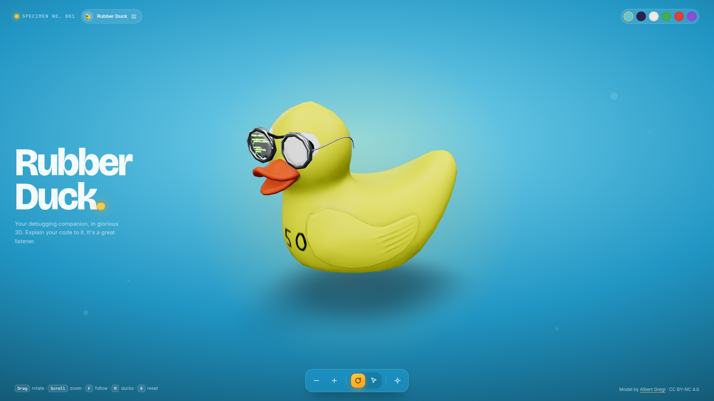

# Rubber Duck

An interactive 3D rubber duck viewer built with React, Three.js and React Three Fiber. Pick a duck, spin it, zoom in, or let it follow your cursor. Explain your code to it. It is a great listener.

[](docs/screenshot.png)

Click the image to view it at full 4K resolution.

## Features

- Nine duck models, from the classic yellow duck to Batduck, Steamduck and Ducksaw
- Model picker with pre-rendered thumbnails
- Auto-rotate and follow-mouse motion modes
- Orbit, zoom and reset camera controls with keyboard shortcuts
- Six scene themes: Bath, Night, Studio, Green, Red and Violet
- Camera framing that adapts to portrait screens

## Getting started

Requires Node.js 20.19 or newer (needed by Vite 8).

```sh
npm install
npm run dev
```

Then open the URL that Vite prints (usually http://localhost:5173).

## Scripts

| Command           | Description                                             |
| ----------------- | ------------------------------------------------------- |
| `npm run dev`     | Start the development server with hot reload            |
| `npm run build`   | Type-check and build for production into `dist/`        |
| `npm run preview` | Serve the production build locally                      |
| `npm run lint`    | Run ESLint                                              |
| `npm run thumbs`  | Regenerate the model picker thumbnails (see below)      |

## Controls

| Input          | Action                     |
| -------------- | -------------------------- |
| Drag           | Rotate the camera          |
| Scroll, `+`, `-` | Zoom in and out           |
| `Space`        | Toggle auto-rotate         |
| `F`            | Toggle follow-mouse mode   |
| `R`            | Reset the view             |
| `M`            | Open the duck picker       |
| `[` / `]`      | Previous / next duck       |

Dragging the duck stops any active motion mode.

## Project structure

```
public/models/         GLB model files
public/models/thumbs/  Picker thumbnails (generated)
scripts/thumbnails.mjs Headless thumbnail renderer
src/App.tsx            Main layout, HUD and keyboard shortcuts
src/camera.ts          Camera defaults and zoom limits
src/models.ts          Duck model registry
src/themes.ts          Scene theme definitions
src/components/        Scene, lights, model loading and the picker dialog
thumbs.html            Entry page used by the thumbnail renderer
```

## Adding a duck

1. Put the `.glb` file in `public/models/`.
2. Add an entry to `MODELS` in `src/models.ts` with its title, author, source URL and license. Optional fields handle problem models:
   - `forceOpaque` for models whose opaque materials are wrongly flagged as transparent
   - `fitOpaqueOnly` to frame the model on its opaque meshes only
   - `followYaw` to rotate the model so its beak faces the cursor in follow mode
   - `lightBoost` to brighten matte models that look too dark
3. Generate its thumbnail:

   ```sh
   npm run thumbs -- <model-id>
   ```

   Omit the model id to regenerate every thumbnail. The script needs Chromium or Chrome installed; set `CHROME=/path/to/browser` if it is not found on your `PATH`.

## Adding a theme

Add an entry to `THEMES` in `src/themes.ts`, then define its background gradient in `src/App.css` under `[data-theme="<id>"]`.

## Credits

All 3D models come from Sketchfab and belong to their respective authors:

| Model           | Author          | License            |
| --------------- | --------------- | ------------------ |
| [Rubber Duck](https://sketchfab.com/3d-models/rubber-duck-7eb15f3c897049f8ba35f8f56f081dff) | Albert Gregl | CC BY-NC 4.0 |
| [Rubber Ducky](https://sketchfab.com/3d-models/rubber-ducky-652fb859ddbc403a9d799e91c0468ef0) | R3indeer | CC BY 4.0 |
| [Rubber Duck Toy](https://sketchfab.com/3d-models/rubber-duck-toy-2fcdc70227df4aafb1d96be15fa622f0) | Prince Obrymec | Sketchfab Standard |
| [Low poly Duck](https://sketchfab.com/3d-models/rubber-duck-8ac5f3720341416b8818cb20f90f2f10) | shalimman | Sketchfab Standard |
| [Inflatable Duck](https://sketchfab.com/3d-models/rubber-inflatable-duck-e41d336c0ba54a1b818685c5bb2d2197) | dmitriev.ivan.d | CC BY 4.0 |
| [Batduck](https://sketchfab.com/3d-models/batman-rubber-duck-fe08ae4ab8a24f6498b9b79644185c6f) | Qlone | CC BY-ND 4.0 |
| [Poo Chi Duck](https://sketchfab.com/3d-models/poo-chi-rubber-duck-e72063d028c54a4986fe56dbfd37a694) | Gaspar.Gaspar1 | CC BY 4.0 |
| [Steamduck](https://sketchfab.com/3d-models/steamduck-9b79537e6de447d8bb6e5a6123d0b794) | ramon_asekas | CC BY 4.0 |
| [Ducksaw](https://sketchfab.com/3d-models/ducksaw-4d11de9629a044fab33d16c167ef7ced) | Duznot | CC BY 4.0 |

Each model's license applies to that model only. Check the terms before reusing a model, as some licenses restrict commercial use or derivative works.
